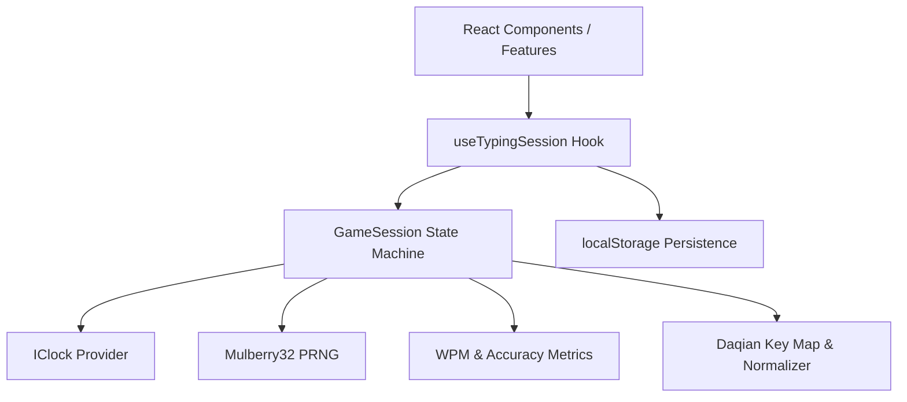
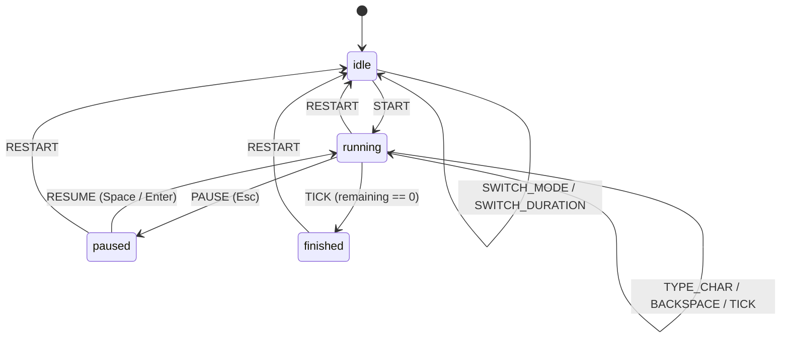

# System Architecture & Technical Specifications — V0.2.0

## 1. Domain-Driven Layered Architecture

TriType Arena adheres to clean architecture principles with strict directional dependency enforcement:
`UI (React Components) → Application (useTypingSession Hook) → Domain Engine (Pure Models & FSM)`

### Invariants:
1. **Domain Isolation**: `src/domain/` contains zero React, DOM, or browser Web API dependencies.
2. **Determinism**: Timing depends strictly on injected `IClock`. Given an identical timestamp sequence and random seed, the game state executes 100% identically across platforms.
3. **State Machine Exclusivity**: All state updates occur via pure dispatched actions to `GameSession`. Direct mutation of internal state is strictly disallowed.

---

## 2. Finite State Machine (`GameSession`)

The session is modeled as an algebraic union of mutually exclusive states:
`type SessionStatus = 'idle' | 'running' | 'paused' | 'finished';`

---

## 3. Key Mechanisms & Anti-Cheat Specifications

### Anti-Cheat: Paste Rejection
- When the user pastes text (`Ctrl+V` or `Cmd+V`), `onPaste` intercepts the event, calls `preventDefault()`, and dispatches `{ type: 'PASTE', text }`.
- `GameSession` rejects paste actions, preserving keystroke validity and preventing sudden WPM surges.

### WPM Calculation & Initial Dampening
- Standard formula: $\text{WPM} = \frac{\text{correctKeys} / 5}{\text{elapsedMinutes}}$.
- For $\text{elapsedSeconds} < 2.0$, raw division creates transient spikes (e.g. 5 keys in 0.5s would equal 600 WPM).
- Dampener: Implements a progressive normalization multiplier $\text{rampRatio} = \frac{\text{elapsedSeconds}}{2.0}$ applied to the 2-second rate floor.

### Typo Recording & Review
- Every keystroke that fails to match the expected character at the current string position creates a `TypoRecord`:
  `{ expected: string, typed: string, word: string, timestamp: number }`.
- Upon session completion, `ResultModal` aggregates mistakes by key pair, presenting the player's weak keys.

### Daqian Keyboard Layout & OS IME Boundary
- Standard CNS 11643 Taiwan Daqian keyboard mapping translates physical keys (`1qaz2wsxedcrfv5tgbyhnu...`) into Bopomofo symbols (`ㄅㄆㄇㄈㄉㄊㄋㄌㄍㄎㄏㄐㄑㄒㄓ...`).
- First tone is implicit (no key press).
- Tones 2, 3, 4, light correspond to physical keys `6` (ˊ), `3` (ˇ), `4` (ˋ), `7` (˙).
- In the UI, the next required keycap glows dynamically to guide typing practice.

---

## 4. Quality Gates & Quality Assurance

| Gate | Tool | Target | Status |
|---|---|---|---|
| G0: Specification | OpenSpec / Markdown | Formal acceptance criteria | Approved |
| G1: TDD RED | Node Test Runner | Pre-written failing tests | Verified |
| G2: Implementation | Pure TypeScript / React | Domain & component code | Complete |
| G3: Typecheck | TypeScript 5.6 Strict | Zero compiler errors | Passed |
| G4: Unit/Feature Tests | Node Test Runner (22/22) | 100% passing core tests | Passed |
| G5: License Audit | Automated AST / regex scan | Permissive MIT, 0 secrets | Passed |
| G6: Production Build | Vite 5.4 Bundler | Optimized minified build | Passed |
| G7: Public Gate | Checklist | Final owner approval | Pending Owner |
