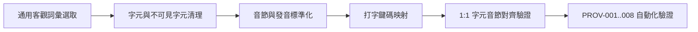

# Vocabulary Provenance & Data Transformation Log

- **Target Version:** v0.4.0
- **Scope:** 1,100 Vocabulary Entries
- **Status:** CONDITIONAL — Structurally validated; original compilation provenance not fully reconstructed.
- **Historical Compatibility:** `NOT VERIFIABLE`
- **Development Merge Decision:** `CLEARED_FOR_DEV_MERGE` (Pending Repository Owner Approval)
- **Public Release Decision:** `CLEARED_FOR_PUBLIC_RELEASE` for current batches; historical data is not cleared.
- **Companion Documents:**
  - Sources: [`SOURCES.md`](./SOURCES.md)
  - License Policy: [`LICENSE_POLICY.md`](./LICENSE_POLICY.md)
  - Review Checklist: [`REVIEW_CHECKLIST.md`](./REVIEW_CHECKLIST.md)

---

## 1. 資料集現況與來源限制

### 1.1 題庫規模
- **英文 (`en`)**：500 筆（初級 200、中級 200、高級 100）
- **簡體拼音 (`pinyin`)**：300 筆（初級 120、中級 120、高級 60）
- **繁體注音 (`zhuyin`)**：300 筆（初級 120、中級 120、高級 60）
- **總計**：1,100 筆

### 1.2 來源追溯邊界（Provenance Limitation）
專案擁有者表示最初題庫由另一 AI 臨時抓入；原始來源、選詞方式、是否大量複製及授權條款均未能確認。英文已改用 [Moby 詞表](./MOBY_ENGLISH.md)，中文已改為[獨立選詞及來源比對的候選資料](./CHINESE_CANDIDATES.md)，舊資料仍存在 Git 歷史；現行三批已依已記錄的來源和授權聲明准予發布；此決策不是法律保證。

> The initial vocabulary sources and whether protected material was copied are unknown; rights and public release remain under review.

---

## 2. 歷史資料相容性審驗（PROV-007 Historical Compatibility）

- **驗證結論**：`Historical Compatibility: NOT VERIFIABLE`
- **正式聲明**：
  > **Current vocabulary IDs and data structures are internally consistent. No trustworthy prior-release baseline was available to prove that historical entries remain unchanged.**
- **基準清查事實紀錄**：
  - 專案在 Tag `v0.3.0`（Commit `6f2ea63`）及 `main` 分支基準（Commit `727d045`）中，並不存在 `src/domain/vocabulary/` 目錄或 `VocabularyEntry` 介面。
  - 前一正式版本僅在 `src/domain/lessons.ts` 中存在 48 筆未標記 ID、無難度分級之靜態展示課程（每模式 16 筆）。
  - 舊中文題庫 ID 源於 V0.4.0 架構，替換後中文使用 `pi-cedict2-*`、`zh-cedict2-*`，英文使用 `en-moby-*` 新 ID，歷史庫存中並無可供逐筆回歸比對之詞庫 ID 基準檔。
  - 本專案拒絕以當前 HEAD 自我生成之資料冒充歷史基準，誠實保留 `NOT VERIFIABLE` 結論。

---

## 3. 資料轉換歷程（Data Transformation Lifecycle）

題庫條目從文字概念轉化為遊戲題目的處理管道如下：

1. **英文資料轉換 (`en`)**:
   - 移除任何非英文字元與空格，嚴格轉換為小寫 ASCII 字母 `[a-z]`。
2. **簡體拼音轉換 (`pinyin`)**:
   - 依據 ISO 7098 拼音標準，將漢字轉寫為聲調拼音提示（`hint`），並將答題字串（`answer`）去除調號以符合一般 QWERTY 鍵盤打字習慣。
3. **繁體注音轉換 (`zhuyin`)**:
   - 依據 CC-CEDICT 拼音機械轉寫為注音符號提示，尚未驗證符合台灣慣用讀音（`hint`），答題字串（`answer`）為注音符號，輸入時由大千鍵盤佈局將實體按鍵映射成符號。

---

## 4. 語言與讀音品質審查紀錄

以下為 V0.4.0 文件記載的部分修正；所用參考與是否完成逐筆核對均未能證實：

1. **拼音拼寫校正**:
   - `绿色`：校正標準輸入法鍵碼為 `lvse`。
   - `复杂`：校正為 `fuza`。
   - 複合詞與成語去調校正：`zerendandang` (責任擔當)、`dulisikao` (獨立思考)、`jingyiqiujing` (精益求精)、`jiyinchongzu` (基因重組)。
2. **台灣注音讀音修正紀錄**:
   - `微`：校正為二聲 `ㄨㄟˊ`（而非大陸讀音一聲 `ㄨㄟ`）。
   - `權`：校正為二聲 `ㄑㄩㄢˊ`。
   - `友誼`：校正為四聲 `ㄧㄡˇ ㄧˋ`。
3. **音節對齊與長度匹配**:
   - 中文 600 筆詞條全數達成「漢字個數 1:1 對應拼音／注音音節個數」，杜絕音節缺漏。

---

## 5. 自動化檢驗紀錄

透過 `scripts/validate-vocabulary-provenance.mjs` 與 `tests/domain/provenance.test.ts` 執行 PROV-001 至 PROV-008 測試，所有 1,100 筆資料均通過結構驗證。
